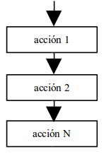
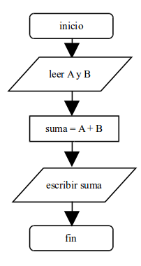
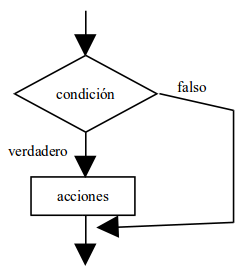
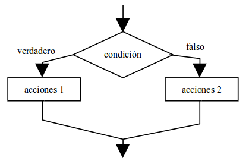
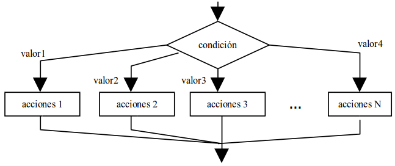
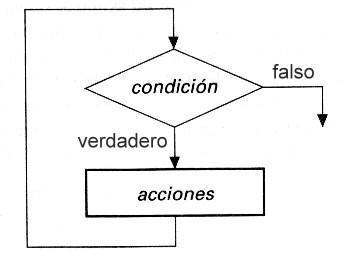
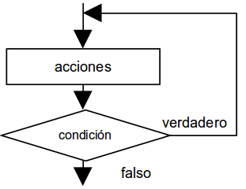
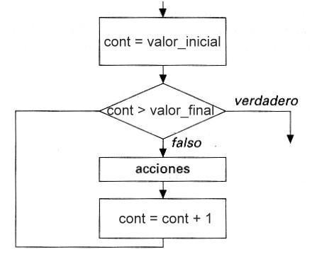

# UD 2. Programación estructurada
{: .no_toc }


# Índice
{: .no_toc }
- TOC
{:toc}

En este tema estudiaremos las estructuras de control que operan dentro de los métodos de los objetos, es decir, en los algoritmos que forman parte de nuestros programas. Es, pues, un tema clásico en los manuales de programación estructurada, solo que nosotros emplearemos las estructuras de control dentro de nuestras clases, de la forma en que lo hace la programación orientada a objetos.

Después de revisar todas las estructuras y ver algunos ejemplos de cada una de ellas, expondremos algunas reglas de estilo fundamentales para aumentar la legibilidad y profesionalidad de nuestro código fuente.

Hablaremos también del control de excepciones, tan importante en Java para lograr aplicaciones robustas y tolerantes a fallos, así como de la implicación del programador en el proceso de control de calidad del software.

## 1. La programación estructurada

El término programación estructurada se refiere a un conjunto de técnicas que han ido evolucionando desde los primeros trabajos del holandés E. Dijkstra. Pese a ser físico, Dijkstra fue uno de los más importantes científicos de la computación hasta su muerte en 2002. Una de sus frases más famosas es:

> "La pregunta de si un computador puede pensar no es más interesante que la pregunta de si un submarino puede nadar"

Estas técnicas de programación estructurada de Dijkstra aumentan la productividad del programador, reduciendo el tiempo requerido para escribir, verificar, depurar y mantener los programas, y por ese motivo han sido plenamente asimiladas por la programación orientada a objetos.

Allá por mayo de 1966, Böhm y Jacopini demostraron (en la revista "Communications of the ACM", vol. 9, nº 5) que se puede escribir cualquier programa propio utilizando solo tres tipos de estructuras de control: la secuencial, la selectiva (o condicional) y la repetitiva. A esto se le llama **Teorema de la programación estructurada**, y define un programa propio como un programa que cumple tres características:

* Posee un sólo punto de inicio y un sólo punto de fin.
* Existe al menos un camino que parte del inicio y llega hasta el fin pasando por todas las partes del programa.
* No existen bucles infinitos.

Realmente, el trabajo de Dijkstra basado en este teorema fue revolucionario, porque lo que venía a decir es que, para construir programas más potentes y en menos tiempo, lo que había que hacer era simplificar las herramientas que se utilizaban para hacerlos, en lugar de complicarlas más. Este regreso a la simplicidad, unido a las técnicas de ingeniería del software, acabó con la crisis del software de los años 70.

Por lo tanto, los programas estructurados deben limitarse a usar tres estructuras:

* Secuencial
* Selectiva (o condicional)
* Repetitiva

La programación orientada a objetos, como vimos en el tema 1, es una evolución de la programación estructurada clásica en la que los algoritmos y los datos se encapsulan en clases que más tarde se instancian en objetos que interactúan entre sí. Pero lo que hay dentro de esos algoritmos siguen siendo programas estructurados. Es decir, la POO es un superconjunto de la programación estructurada clásica, y por eso es pertinente que, en este punto, estudiemos esas estructuras detenidamente.

## 2. Estructura secuencial

La estructura secuencial es aquélla en la que una acción sigue a otra (en secuencia). Esta es la estructura algorítmica básica, en la que las instrucciones se ejecutan una tras otra, en el mismo orden en el que fueron escritas.

La estructura secuencial, por lo tanto, es la más simple de las tres estructuras permitidas. A continuación vemos su representación mediante diagrama de flujo y Java:





**Ejemplo:** Vamos a escribir un algoritmo completamente secuencial que calcule la suma de dos números, a y b.

```java
// Algoritmo suma
public class Suma {
    public static void main(String[] args) {
        int a, b, suma;
        a = Integer.parseInt(System.console().readLine());
        b = Integer.parseInt(System.console().readLine());
        suma = a + b;
        System.out.println(suma);
    }
}
```

## 3. Estructuras selectivas (condicionales)

Los algoritmos que usan únicamente estructuras secuenciales están muy limitados y no tienen ninguna utilidad real. Esa utilidad aparece cuando existe la posibilidad de ejecutar una de entre varias secuencias de instrucciones dependiendo de alguna condición asociada a los datos del programa.

Las estructuras selectivas pueden ser de tres tipos:

* Simples
* Dobles
* Múltiples

### 3.1. Condicional simple

La estructura condicional simple se escribe así:



```java
if (condicion) {
    acciones
}
```

La condición que aparece detrás de `if` es siempre una expresión lógica, es decir, una expresión cuyo resultado es "verdadero" o "falso". Si el resultado es verdadero, entonces se ejecutan las acciones situadas entre `{` y `}`. Si es falso, se saltan las acciones y se prosigue por la siguiente instrucción (lo que haya debajo de la llave de cierre).

**Ejemplo:** El siguiente código calcula el área y el perímetro de un rectángulo usando un condicional simple:

```java
double base, altura, area, perimetro;
base = Double.parseDouble(System.console().readLine());
altura = Double.parseDouble(System.console().readLine());

if ((base > 0) && (altura > 0)) {
    area = base * altura;
    perimetro = 2 * base + 2 * altura;
    System.out.println("Area = " + area);
    System.out.println("Perimetro = " + perimetro);
}

if ((base <= 0) || (altura <= 0)) {
    System.out.println("Los datos son incorrectos");
}
```

Observa que, en la primera instrucción condicional `if ((base > 0) && (altura > 0))` se comprueba que los dos datos sean positivos; en caso de serlo, se procede al cálculo del área y el perímetro. Más abajo hay otra condicional `if ((base <= 0) || (altura <= 0))` para el caso de que alguno de los datos sea negativo o cero: en esta ocasión, se imprime en la pantalla un mensaje de error.

### 3.2. Condicional doble

La forma doble de la instrucción condicional es:



```java
if (condicion) {
    acciones-1
} else {
    acciones-2
}
```

En esta forma, la instrucción funciona del siguiente modo: si el resultado de la condición es verdadero, entonces se ejecutan las acciones de la primera parte, es decir, las `acciones-1`. Si es falso, se ejecutan las acciones de la parte `else`, es decir, las `acciones-2`.

**Ejemplo:** Podemos reescribir nuestro algoritmo del rectángulo usando una alternativa doble:

```java
double base, altura, area, perimetro;
base = Double.parseDouble(System.console().readLine());
altura = Double.parseDouble(System.console().readLine());

if ((base > 0) && (altura > 0)) {
    area = base * altura;
    perimetro = 2 * base + 2 * altura;
    System.out.println("Area = " + area);
    System.out.println("Perimetro = " + perimetro);
} else {
    System.out.println("Los datos son incorrectos");
}
```

Lo más interesante de este algoritmo es compararlo con el anterior, ya que hace exactamente lo mismo. ¡Siempre hay varias maneras de resolver el mismo problema! Pero esta solución es un poco más sencilla, al ahorrarse la segunda condición, que va implícita en el `else`.

### 3.3. Condicional múltiple

En algunas ocasiones nos encontraremos con selecciones en las que hay más de dos alternativas (es decir, en las que no basta con los valores "verdadero" y "falso"). Siempre es posible plasmar estas selecciones complejas usando varias estructuras `if-else if-else if...` anidadas, pero, cuando el número de alternativas es grande, esta solución puede plantear grandes problemas de escritura y legibilidad.

Sin embargo, hay que dejar clara una cosa: cualquier instrucción condicional múltiple puede ser sustituida por un conjunto de instrucciones condicionales simples y dobles totalmente equivalente.

La estructura condicional múltiple sirve, por tanto, para simplificar estos casos de condiciones con muchas alternativas. Su sintaxis general es:



```java
switch (expresion) {
    case valor1: 
        acciones-1;
        break;
    case valor2: 
        acciones-2;
        break;
    case valor3: 
        acciones-3;
        break;
    default: 
        acciones-N;
}
```

Su funcionamiento es el siguiente: se evalúa `expresion`, que en esta ocasión no tiene que ser de tipo lógico, sino que puede ser entero, carácter, etc. El resultado de `expresion` se compara con cada uno de los valores `valor1`, `valor2`... `valorN`. Si coincide con alguno de ellos, se ejecutan únicamente las acciones situadas a la derecha del valor coincidente. Si ningún valor coincide, se ejecutan las acciones del bloque `default`. Esta última parte no es obligatoria.

**Ejemplo:** Construyamos un algoritmo que escriba los nombres de los días de la semana en función del valor de una variable entera llamada `dia`. Su valor se introducirá por teclado. Los valores posibles de la variable `dia` serán del 1 al 7: cualquier otro valor debe producir un error.

```java
int dia;
dia = Integer.parseInt(System.console().readLine());

switch(dia) {
    case 1: 
        System.out.println("Lunes");
        break;
    case 2: 
        System.out.println("Martes");
        break;
    case 3: 
        System.out.println("Miércoles");
        break;
    case 4: 
        System.out.println("Jueves");
        break;
    case 5: 
        System.out.println("Viernes");
        break;
    case 6: 
        System.out.println("Sábado");
        break;
    case 7: 
        System.out.println("Domingo");
        break;
    default: 
        System.out.println("Número incorrecto");
}
```

En este programa, la variable `dia`, una vez leída, se compara con los siete valores posibles. Si no coincide con ninguno de los siete valores, se ejecuta la parte `default`.

## 4. Estructuras repetitivas (bucles)

Los ordenadores se diseñaron inicialmente para realizar tareas sencillas y repetitivas. El ser humano es de lo más torpe acometiendo tareas repetitivas: pronto le falla la concentración y comienza a tener descuidos. Los ordenadores programables, en cambio, pueden realizar la misma tarea muchas veces por segundo durante años y nunca se aburren.

La estructura repetitiva, por tanto, reside en la naturaleza misma de los ordenadores y consiste, simplemente, en repetir varias veces un conjunto de instrucciones. Las estructuras repetitivas también se llaman **bucles**, **lazos**, **iteraciones** o **loops**.

Los bucles tienen que repetir un conjunto de instrucciones un número finito de veces. Si no, nos encontraremos con un bucle infinito y el algoritmo no funcionará. Para conseguir que el bucle se repita sólo un número finito de veces, tiene que existir una **condición de salida**.

Por tanto, los bucles se componen, básicamente, de dos elementos:

a. Un **cuerpo del bucle** o conjunto de instrucciones que se ejecutan repetidamente.
b. Una **condición de salida** para dejar de repetir las instrucciones y continuar con el resto del algoritmo.

Existen tres tipos de bucles:

* **Bucle "mientras... hacer" (`while`)**: la condición de salida está al principio del bucle.
* **Bucle "hacer... mientras" (`do...while`)**: la condición de salida está al final del bucle.
* **Bucle "para" (`for`)**: la condición de salida está al principio y se realiza con un contador automático.

### 4.1. Bucle "mientras... hacer"

El bucle `while` es una estructura que se repite mientras una condición sea verdadera:



```java
while (condicion) {
    acciones (cuerpo del bucle)
}
```

Cuando se llega a una instrucción `while`, se evalúa la condición. Si es verdadera, se realizan las acciones y se regresa al principio de la instrucción `while`. Y así hasta que la condición se haga falsa.

**Ejemplo:** Escribir un algoritmo que muestre en la pantalla todos los números enteros entre 1 y 100.

```java
int cont = 0;
while (cont < 100) {
    cont = cont + 1;
    System.out.println(cont);
}
```

### 4.2. Bucle "Hacer... mientras"

El bucle `do...while` evalúa la condición de salida al final del bucle:



```java
do {
    acciones (cuerpo del bucle)
} while (condicion);
```

Las acciones del cuerpo de un bucle `do...while` se ejecutan **al menos una vez**, a diferencia del bucle `while`.

**Ejemplo:** Diseñar un algoritmo que escriba todos los números enteros entre 1 y 100 utilizando `do...while`:

```java
int cont = 0;
do {
    cont = cont + 1;
    System.out.println(cont);
} while (cont < 100);
```

### 4.3. Bucle "para"

Cuando el número de repeticiones es fijo y conocido de antemano, lo más cómodo es usar un bucle `for`:



```java
for (inicializacion; condicion; incremento) {
    acciones
}
```

**Ejemplo 1:** Diseñar un algoritmo que escriba todos los números enteros entre 1 y 100 utilizando un bucle `for`:

```java
for (int cont = 1; cont <= 100; cont = cont + 1) {
    System.out.println(cont);
}
```

**Ejemplo 2:** Diseñar un algoritmo que escriba todos los números enteros impares entre 1 y 100:

```java
for (int cont = 1; cont <= 100; cont = cont + 2) {
    System.out.println(cont);
}
```

### 4.4. Contadores, acumuladores, conmutadores

#### 4.4.1. Contadores

Un contador es una variable (casi siempre de tipo entero) cuyo valor se incrementa o decrementa en cada repetición de un bucle. Se suelen denotar como `cont` o `i`.

* Se inicializa antes del bucle (`i = 1`).
* Se modifica dentro del bucle (`i++` o `i = i + 1`).
* Se utiliza en la condición de salida (`i <= 10`).

**Ejemplo:** Tabla de multiplicar de un número N:

```java
int i = 1;
int n = Integer.parseInt(System.console().readLine());

while (i <= 10) {
    System.out.println(n * i);
    i++;
}
```

#### 4.4.2. Acumuladores

Las variables acumuladoras almacenan resultados sucesivos.

**Ejemplo:** Sumar 10 números introducidos por teclado:

```java
int suma = 0;
for (int i = 1; i <= 10; i++) {
    int n = Integer.parseInt(System.console().readLine());
    suma = suma + n;
}
System.out.println(suma);
```

#### 4.4.3. Conmutadores

Un conmutador (o interruptor) es una variable booleana que cambia de estado según ciertas condiciones para controlar la salida del bucle.

**Ejemplo:** Sumar números positivos hasta introducir uno negativo:

```java
int suma = 0;
boolean terminar = false;

while (!terminar) {
    System.out.println("Introduce un número (negativo para terminar):");
    int n = Integer.parseInt(System.console().readLine());
    if (n >= 0) {
        suma = suma + n;
    } else {
        terminar = true;
    }
}
System.out.println(suma);
```

Uso equivalente con **centinela** y bucle `do...while`:

```java
int suma = 0;
int n;

do {
    System.out.println("Introduce un número (negativo para terminar):");
    n = Integer.parseInt(System.console().readLine());
    if (n >= 0) {
        suma = suma + n;
    }
} while (n >= 0);

System.out.println(suma);
```

## 5. Instrucciones de salto

### 5.1.1. break

La sentencia `break` sale abruptamente del bloque actual (bucle o `switch`). El único uso recomendado de esta instrucción es dentro de un bloque `switch`.

### 5.1.2. continue

La sentencia `continue` fuerza la finalización prematura de la iteración actual de un bucle, pasando a la siguiente. Su uso generalmente denota un bucle mal planteado.

### 5.1.3. return

`return` debe ser la última instrucción de un método para devolver control o un valor. Se desaconseja el uso de múltiples `return` o `return` prematuros, salvo en salidas de emergencia excepcionales.

## 6. Control de excepciones

El manejo de excepciones consiste en prever y capturar los posibles errores de ejecución para redirigirlos a una rutina de código preprogramada, evitando que el programa finalice inesperadamente.

### 6.1. El bloque try-catch-finally

Sintaxis en Java:

```java
try {
    // Sentencias que pueden fallar
} catch (ExcepcionTipo1 e) {
    // Control de la excepción 1
} catch (ExcepcionTipo2 e) {
    // Control de la excepción 2
} finally {
    // Código opcional que se ejecuta siempre
}
```

**Ejemplo:** Manejo de división por cero (`ArithmeticException`):

```java
class Test {
    public static void main(String[] args) {
        int a = 10, b = 0, c;
        try {
            c = a / b;
        } catch (ArithmeticException e) {
            System.out.println("Error al hacer la división");
            c = 0;
        }
        System.out.println("Resultado: " + c);
    }
}
```

### 6.2. try-with-resources

Pensado para liberar recursos automáticamente (archivos, conexiones) al terminar el bloque:

```java
try (BufferedReader br = new BufferedReader(new FileReader("file.txt"))) {
    // Lectura de archivo
} catch (IOException e) {
    // Manejo de error
}
```

### 6.3. El manejo de excepciones y la entrada de datos por teclado

Ejemplo de clase completa para solicitar datos por teclado de forma segura:

```java
import java.io.InputStreamReader;
import java.io.BufferedReader;

public class Suma {
    public static void main(String[] args) {
        InputStreamReader isr = new InputStreamReader(System.in);
        BufferedReader br = new BufferedReader(isr);
        int s1 = 0, s2 = 0;

        try {
            System.out.print("Sumando 1: ");
            s1 = Integer.parseInt(br.readLine());
            System.out.print("Sumando 2: ");
            s2 = Integer.parseInt(br.readLine());
        } catch (Exception e) {
            System.out.println("Se ha producido un error. Asegúrese de haber introducido dos números.");
        }

        int suma = s1 + s2;
        System.out.println("La suma es " + s1 + " + " + s2 + " = " + suma);
    }
}
```

### 6.4. Excepciones poco excepcionales: un uso incorrecto de las excepciones

Utilizar excepciones para controlar el flujo normal de una aplicación es una mala práctica:

```java
// *** ¡¡OJO!! CÓDIGO DE MALA CALIDAD - NO USAR ***
Scanner sc = new Scanner(System.in);
while (true) {
    try {
        System.out.print("Introduce un número: ");
        int num = sc.nextInt();
        System.out.println("Has introducido: " + num);
    } catch (Exception e) {
        System.out.println("Fin de la lectura (dato no válido)");
        break; // salida del bucle mediante excepción
    }
}
```

Las excepciones deben reservarse exclusivamente para situaciones excepcionales y errores inesperados.

## 7. Hemos aprendido...

* Estructuras de control de la programación clásica: **secuencia**, **selección** e **iteración**.
* Control y captura de **excepciones** para asegurar la robustez del código en Java.
* Reglas de estilo y buenas prácticas de programación estructurada.
