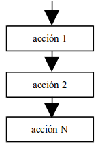
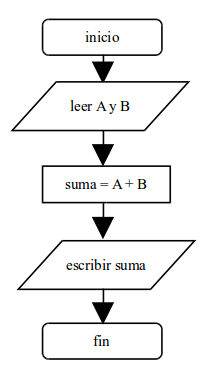

## 2.2. Estructura secuencial

La estructura secuencial es aquélla en la que una acción sigue a otra (en secuencia). Esta es la estructura algorítmica básica, en la que las instrucciones se ejecutan una tras otra, en el mismo orden en el que fueron escritas.

La estructura secuencial, por lo tanto, es la más simple de las tres estructuras permitidas. A continuación vemos su representación mediante diagrama de flujo y Java:



**Ejemplo:** Vamos a escribir un algoritmo completamente secuencial que calcule la suma de dos números, a y b.

```java
// Algoritmo suma
public class Suma {
    public static void main(String[] args) {
        int a, b, suma;
        a = Integer.parseInt(System.console().readLine());
        b = Integer.parseInt(System.console().readLine());
        suma = a + b;
        System.out.println(suma);
    }
}
```

Podemos dibujar el algoritmo anterior con un **diagrama de flujo** para observar la estructura secuencial (de arriba a abajo) de manera más visual:



