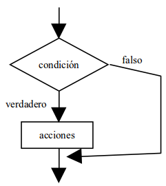
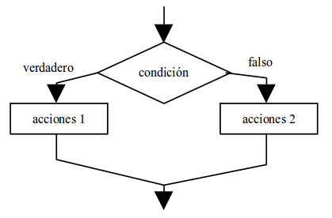
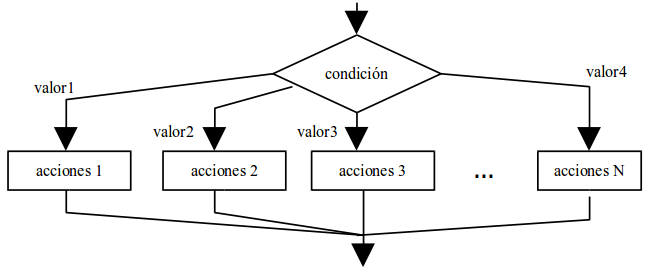

## 2.3. Estructura condicional
{: .no_toc }

- TOC
{:toc}

Los algoritmos que usan únicamente estructuras secuenciales están muy limitados y no tienen ninguna utilidad real. Esa utilidad aparece cuando existe la posibilidad de ejecutar una de entre varias secuencias de instrucciones dependiendo de alguna condición asociada a los datos del programa.

Las **estructuras selectivas** o **condicionales** pueden ser de tres tipos:

* Simples
* Dobles
* Múltiples

### 2.3.1. Condicional simple

La estructura condicional simple se escribe así:

```java
if (condicion) {
    acciones
}
```

Y gráficamente se suele representar así:



La condición que aparece detrás de `if` es siempre una expresión lógica, es decir, una expresión cuyo resultado es "verdadero" o "falso". Si el resultado es verdadero, entonces se ejecutan las acciones situadas entre `{` y `}`. Si es falso, se saltan las acciones y se prosigue por la siguiente instrucción (lo que haya debajo de la llave de cierre).

**Ejemplo:** El siguiente código calcula el área y el perímetro de un rectángulo usando un condicional simple:

```java
double base, altura, area, perimetro;
base = Double.parseDouble(System.console().readLine());
altura = Double.parseDouble(System.console().readLine());

if ((base > 0) && (altura > 0)) {
    area = base * altura;
    perimetro = 2 * base + 2 * altura;
    System.out.println("Area = " + area);
    System.out.println("Perimetro = " + perimetro);
}

if ((base <= 0) || (altura <= 0)) {
    System.out.println("Los datos son incorrectos");
}
```

Observa que, en la primera instrucción condicional `if ((base > 0) && (altura > 0))` se comprueba que los dos datos sean positivos; en caso de serlo, se procede al cálculo del área y el perímetro. Más abajo hay otra condicional `if ((base <= 0) || (altura <= 0))` para el caso de que alguno de los datos sea negativo o cero: en esta ocasión, se imprime en la pantalla un mensaje de error.

### 2.3.2. Condicional doble

La forma doble de la instrucción condicional es:

```java
if (condicion) {
    acciones-1
} else {
    acciones-2
}
```



En esta forma, la instrucción funciona del siguiente modo: si el resultado de la condición es verdadero, entonces se ejecutan las acciones de la primera parte, es decir, las `acciones-1`. Si es falso, se ejecutan las acciones de la parte `else`, es decir, las `acciones-2`.

**Ejemplo:** Podemos reescribir nuestro algoritmo del rectángulo usando una alternativa doble:

```java
double base, altura, area, perimetro;
base = Double.parseDouble(System.console().readLine());
altura = Double.parseDouble(System.console().readLine());

if ((base > 0) && (altura > 0)) {
    area = base * altura;
    perimetro = 2 * base + 2 * altura;
    System.out.println("Area = " + area);
    System.out.println("Perimetro = " + perimetro);
} else {
    System.out.println("Los datos son incorrectos");
}
```

Lo más interesante de este algoritmo es compararlo con el anterior, ya que hace exactamente lo mismo. ¡Siempre hay varias maneras de resolver el mismo problema! Pero esta solución es un poco más sencilla, al ahorrarse la segunda condición, que va implícita en el `else`.

### 2.3.3. Condicional múltiple

En algunas ocasiones nos encontraremos con selecciones en las que hay más de dos alternativas (es decir, en las que no basta con los valores "verdadero" y "falso"). Siempre es posible plasmar estas selecciones complejas usando varias estructuras `if-else if-else if...` anidadas, pero, cuando el número de alternativas es grande, esta solución puede plantear grandes problemas de escritura y legibilidad.

Sin embargo, hay que dejar clara una cosa: cualquier instrucción condicional múltiple puede ser sustituida por un conjunto de instrucciones condicionales simples y dobles totalmente equivalente.

La estructura condicional múltiple sirve, por tanto, para simplificar estos casos de condiciones con muchas alternativas. Su sintaxis general tiene dos formas: la tradicional, más larga y farragosa, y la moderna, más compacta. Ambas son equivalentes:

```java
// Instrucción switch en versión Java tradicional
switch (expresion) {
    case valor1: 
        acciones-1;
        break;
    case valor2: 
        acciones-2;
        break;
    case valor3: 
        acciones-3;
        break;
    default: 
        acciones-N;
}

// Instrucción switch a partir de Java moderno (a partir de Java 14)
switch (expresion) {
    case valor1 -> acciones1;
    case valor2 -> acciones2;
    case valor3 -> acciones3;
    default -> accionesN;
}
```

Su funcionamiento es el siguiente: se evalúa `expresion`, que en esta ocasión no tiene que ser de tipo lógico, sino que puede ser entero, carácter, etc. El resultado de `expresion` se compara con cada uno de los valores `valor1`, `valor2`... `valorN`. Si coincide con alguno de ellos, se ejecutan únicamente las acciones situadas a la derecha del valor coincidente. Si ningún valor coincide, se ejecutan las acciones del bloque `default`. Esta última parte no es obligatoria.

Lo podemos mostrar gráficamente como un diagrama:



**Ejemplo:** Construyamos un algoritmo que escriba los nombres de los días de la semana en función del valor de una variable entera llamada `dia`. Su valor se introducirá por teclado. Los valores posibles de la variable `dia` serán del 1 al 7: cualquier otro valor debe producir un error.

```java
int dia;
dia = Integer.parseInt(System.console().readLine());

switch(dia) {
    case 1 ->  System.out.println("Lunes");
    case 2 ->  System.out.println("Martes");
    case 3 ->  System.out.println("Miércoles");
    case 4 ->  System.out.println("Jueves");
    case 5 ->  System.out.println("Viernes");
    case 6 ->  System.out.println("Sábado");
    case 7 ->  System.out.println("Domingo");
    default -> System.out.println("Número incorrecto");
}
```

En este programa, la variable `dia`, una vez leída, se compara con los siete valores posibles. Si no coincide con ninguno de los siete valores, se ejecuta la parte `default`.
