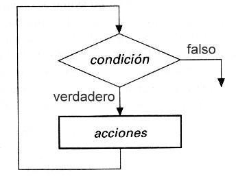
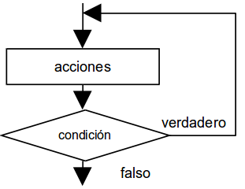
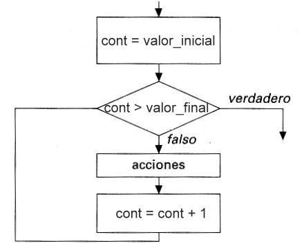

## 2.4. Estructura repetitiva (bucles)
{: .no_toc }

- TOC
{:toc}

Los ordenadores se diseñaron inicialmente para realizar tareas sencillas y repetitivas. El ser humano es de lo más torpe acometiendo tareas repetitivas: pronto le falla la concentración y comienza a tener descuidos. Los ordenadores programables, en cambio, pueden realizar la misma tarea muchas veces por segundo durante años y nunca se aburren.

La estructura repetitiva, por tanto, reside en la naturaleza misma de los ordenadores y consiste, simplemente, en repetir varias veces un conjunto de instrucciones. Las estructuras repetitivas también se llaman **bucles**, **lazos**, **iteraciones** o **loops**.

Los bucles tienen que repetir un conjunto de instrucciones un número finito de veces. Si no, nos encontraremos con un bucle infinito y el algoritmo no funcionará. Para conseguir que el bucle se repita sólo un número finito de veces, tiene que existir una **condición de salida**.

Por tanto, los bucles se componen, básicamente, de dos elementos:

a. Un **cuerpo del bucle** o conjunto de instrucciones que se ejecutan repetidamente.
b. Una **condición de salida** para dejar de repetir las instrucciones y continuar con el resto del algoritmo.

Existen tres tipos de bucles:

* **Bucle mientras (`while`)**: la condición de salida está al principio del bucle.
* **Bucle hacer... mientras (`do...while`)**: la condición de salida está al final del bucle.
* **Bucle para (`for`)**: la condición de salida está al principio y se realiza con un contador automático.

### 2.4.1. Bucle mientras

El bucle `while` es una estructura que se repite mientras una condición sea verdadera:

```java
while (condicion) {
    acciones (cuerpo del bucle)
}
```

Su representación gráfica es esta:



Cuando se llega a una instrucción `while`, se evalúa la condición. Si es verdadera, se realizan las acciones y se regresa al principio de la instrucción `while`. Y así hasta que la condición se haga falsa.

**Ejemplo:** Escribir un algoritmo que muestre en la pantalla todos los números enteros entre 1 y 100.

```java
int cont = 0;
while (cont < 100) {
    cont = cont + 1;
    System.out.println(cont);
}
```

### 2.4.2. Bucle hacer... mientras

El bucle `do...while` evalúa la condición de salida al final del bucle. Todo bucle `do... while` puede escribirse como un bucle `while`, pero al revés no siempre sucede. 


```java
do {
    acciones (cuerpo del bucle)
} while (condicion);
```



Las acciones del cuerpo de un bucle `do...while` se ejecutan **al menos una vez**, a diferencia del bucle `while`, que podría no llegar a ejecutarse ninguna vez.

**Ejemplo:** Diseñar un algoritmo que escriba todos los números enteros entre 1 y 100 utilizando `do...while`:

```java
int cont = 0;
do {
    cont = cont + 1;
    System.out.println(cont);
} while (cont < 100);
```

Hay determinadas situaciones donde un `do... while` puede ser más ventajoso, o generar un código más comprensible, que un bucle `while`convencional. Pero el bucle `while` siempre será una solución perfectamente aceptable para la estructura repetitiva.

### 2.4.3. Bucle para (for)

Cuando el número de repeticiones es fijo y conocido de antemano, lo más cómodo es usar un bucle `for`.

Esta estructura repite las acciones del bucle un número prefijado de veces e incrementa automáticamente una variable contador en cada repetición. Su forma general es:

```java
for (inicializacion; condicion; incremento) {
    acciones
}
```

La inicialización consiste en la asignación del valor inicial a una variable contador (por ejemplo, `cont` o `i`, de *índice*). La primera vez que se ejecutan las acciones del cuerpo del bucle, la variable `cont` tendrá el valor especificado en la inicialización. En la siguiente repetición, la variable contador se incrementará según lo expresado en la sección incremento (por ejemplo, `cont = cont + 1`, o bien su abreviatura `cont++`), y así sucesivamente. El bucle se repetirá mientras que se cumpla la condición.

El bucle `for` se representa de deferentes formas según el tipo de diagrama de flujo. Una representación habitual es la que lo muestra como un bucle `while`, pues en el fondo es lo mismo que un `while` controlado por contador:




**Ejemplo 1:** Diseñar un algoritmo que escriba todos los números enteros entre 1 y 100 utilizando un bucle `for`:

```java
for (int cont = 1; cont <= 100; cont = cont + 1) {
    System.out.println(cont);
}
```

**Ejemplo 2:** Diseñar un algoritmo que escriba todos los números enteros impares entre 1 y 100:

```java
for (int cont = 1; cont <= 100; cont = cont + 2) {
    System.out.println(cont);
}
```

XXX
Contadores, acumuladores, conmutadores
Asociadas a los bucles se encuentran a menudo algunas variables auxiliares. Como siempre se utilizan de la misma manera, las llamamos con un nombre propio (contador, acumulador, etc.), pero hay que dejar claro que no son más que variables comunes, aunque se usan de un modo especial. 
Contadores
Un contador es una variable (casi siempre de tipo entero) cuyo valor se incrementa o decrementa en cada repetición de un bucle. Es habitual llamar a esta variable "cont" (de contador) o, con más frecuencia, "i" (de índice). A partir de ahora nosotros la llamaremos de este último modo.
El contador suele usarse de este modo:
1) Se inicializa antes de que comience el bucle. Es decir, se le da un valor inicial. Por ejemplo:
i = 5;
2) Se modifica dentro del cuerpo del bucle. Lo más habitual es que se incremente su valor en una unidad. Por ejemplo:
i = i + 1;
Esto quiere decir que el valor de la variable "i" se incrementa en una unidad y es asignado de nuevo a la variable contador. Es decir, si i valía 5 antes de esta instrucción, i valdrá 6 después.
Otra forma típica del contador es:
i = i – 1;
En este caso, la variable se decrementa en una unidad; si cont valía 5 antes de la instrucción, tendremos que cont valdrá 4 después de su ejecución.
El incremento o decremento no tiene por qué ser de una unidad. La cantidad que haya que incrementar o decrementar vendrá dada por la naturaleza del problema.
Ten en cuenta que en Java, y en todos los lenguajes herederos de C, existe la sintaxis alternativa i++ e i-- para representar estos incrementos y decrementos.
i++;   // Equivalente a i = i + 1
i--;   // Equivalente a i = i - 1
3) Se utiliza en la condición de salida del bucle. Normalmente, se compara con el valor máximo (o mínimo) que debe alcanzar el contador para dejar de repetir las instrucciones del bucle.
Ejemplo: Escribir un algoritmo que escriba la tabla de multiplicar hasta el 100 de un número N introducido por el usuario
{
   int i, n;
   n = Integer.parseInt(System.console().readLine());
   i = 1;
   while (i <= 10) {
      System.out.println(n * i);
      i++;
   }
}
El uso de contadores es casi omnipresente en bucles "mientras" y "repetir", aunque es posible crear bucles que funcionen sin contadores. Recuerda que siempre hay que asignar al contador un valor inicial para la primera ejecución del bucle (i = 1 en nuestro ejemplo) e ir incrementándolo (o decrementándolo, según el algoritmo) en cada repetición con una instrucción del tipo i = i + 1 o i++ en el cuerpo del bucle. De lo contrario habremos escrito un bucle infinito.
Por último, hay que prestar atención a la condición de salida, que debe estar asociada al valor del contador en la última repetición del bucle (en nuestro caso, 100). Mucho cuidado con el operador relacional (<, >, <=, >=, etc) que usemos, porque el bucle se puede ejecutar más o menos veces de lo previsto. Por cierto: suele ser buena idea evitar el operador "==" en las condiciones de salida de los bucles, sobre todo si estamos trabajando con números reales.
Acumuladores
Las variables acumuladoras tienen la misión de almacenar resultados sucesivos, es decir, de acumular resultados, de ahí su nombre.
Las variables acumuladores también debe ser inicializadas. Si llamamos "acum" a un acumulador, escribiremos antes de iniciar el bucle algo como esto:
acum = 0;
Por supuesto, el valor inicial puede cambiar, dependiendo de la naturaleza del problema. Más tarde, en el cuerpo del bucle, la forma en la que nos la solemos encontrar es:
acum = acum + n;
...siendo n otra variable. Si esta instrucción va seguida de otras:
acum = acum + m;
acum = acum + p;
...estaremos acumulando en la variable "acum" los valores de las variables n, m, p, etc, lo cual resulta a veces muy útil para resolver ciertos problemas repetitivos.
Ejemplo: Escribir un algoritmo que pida 10 números por el teclado y los sume, mostrando el resultado.
{
  int i, n, suma;
  suma = 0;
  for (i = 1; i <= 10; i++) {
     n = Integer.parseInt(System.console.readLine());
     suma = suma + n;
  }
  System.out.println(suma);
}
En este algoritmo, i es una variable contador típica de bucle. Se ha usado un bucle "para", que es lo más sencillo cuando conocemos previamente el número de repeticiones (10 en este caso). La variable n se usa para cada uno de los números introducidos por el teclado, y la variable suma es el acumulador, donde se van sumando los diferentes valores que toma n en cada repetición.
Observa como, al principio del algoritmo, se le asigna al acumulador el valor 0.  Esta es una precaución importante que se debe tomar siempre porque el valor que tenga una variable que no haya sido usada antes es desconocido (no tiene por qué ser 0)
Conmutadores
Un conmutador (o interruptor) es una variable que sólo puede tomar dos valores. Pueden ser, por tanto, de tipo booleano, aunque también pueden usarse variables enteras o de tipo carácter.
La variable conmutador recibirá uno de los dos valores posibles antes de entrar en el bucle. Dentro del cuerpo del bucle, debe cambiarse ese valor bajo ciertas condiciones. Utilizando el conmuntador en la condición de salida del bucle, puede controlarse el número de repeticiones. 
Ejemplo: Escribir un algoritmo que sume todos los números positivos introducidos por el usuario a través del teclado. Para terminar de introducir números, el usuario tecleará un número negativo.
{
  int n, suma;
  boolean terminar;


  suma = 0;
  terminar = false;
  while (terminar == falso) {
      System.out.println("Introduce un número (negativo para terminar)");
      n = Integer.parseInt(System.console.readLine());
      if (n >= 0) {
         suma = suma + n;
      }
      else {
         terminar = true;
      }
   }
   System.out.println(suma);
}
Este algoritmo es una variación del ejemplo con acumuladores que vimos más atrás. Entonces el usuario introducía 10 números, y ahora puede ir introduciendo números indefinidamente, hasta que se canse. ¿Cómo indica al ordenador que ha terminado de introducir números? Simplemente, tecleando un número negativo.
El bucle se controla por medio de la variable "terminar": es el conmutador. Sólo puede tomar dos valores: "verdadero", cuando el bucle debe terminar, y "falso", cuando el bucle debe repetirse una vez más. Por lo tanto, "terminar" valdrá "falso" al principio, y sólo cambiará a "verdadero" cuando el usuario introduzca un número negativo. 
A veces, el conmutador puede tomar más de dos valores. Entonces ya no se le debe llamar, estrictamente hablando, conmutador. Cuando la variable toma un determinado valor especial, el bucle termina. A ese "valor especial" se le suele denominar valor centinela.
Ejemplo: Escribir un algoritmo que sume todos los números positivos introducidos por el usuario a través del teclado. Para terminar de introducir números, el usuario tecleará un número negativo.
{
  int n, suma;


  suma = 0;
  terminar = false;
  do {
      System.out.println("Introduce un número (negativo para terminar)");
      n = Integer.parseInt(System.console.readLine());
      if (n >= 0) {
         suma = suma + n;
      }
   }
   while (n >= 0);
   System.out.println(suma);
}
En esta ocasión, las repeticiones se controlan con la variable n, de modo que el bucle termina cuando n < 0. Por lo tanto, n se utiliza para ir asignando valores al acumulador suma, y también para salir del bucle: es el valor centinela.
Observa que, en esta ocasión, ha sido más sencillo resolver el problema con un bucle "do... while" y un centinela que con un bucle "while" y un conmutador, porque nos ha quedado una solución más corta.
