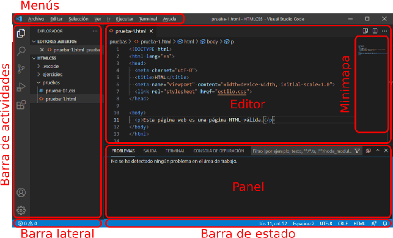
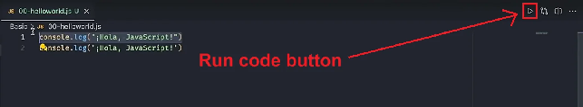

## Apéndice 2. Visual Studio Code

**Visual Studio Code** es un editor de código fuente ligero, pero muy potente, creado por Microsoft con licencia libre.

**No suele considerarse un IDE completo** como IntelliJ, Netbeans o Eclipse, pero puede convertirse en un entorno muy poderoso gracias a su sistema de extensiones o plugins.

Nosotros recomendamos aprender a usarlo porque está muy presente a nivel profesional. Si te acosumbras a usar, por ejemplo, IntelliJ, solo te servirá para programar en Java y pocos lenguajes más. ¡Con Java, IntelliJ encaja como un guante porque es un herramienta diseñada a medida para ello\! 

En cambio, Visual Studio es más como una multiherramienta: **sirve para todo, aunque no es 100% perfecta para nada**. Pero esa versatilidad hace que **esté presente en todas partes**.

Así que es casi seguro que te la vas a encontrar el día de mañana en tu vida profesional. ¿Por qué no empezar a usarla hoy mismo?

Las características clave de VS Code son:

* **Es multilenguaje**: funciona con Java, Python, JavaScript, C++, HTML, etc.  
  * **Funciona con extensiones o plugins**: puedes añadir funcionalidades como depuración, autocompletado avanzado, soporte para frameworks, etc.  
  * **Tiene un terminal integrado**: puedes correr comandos sin salir del editor.  
  * **Es ligero y rápido**: abre proyectos grandes sin consumir tantos recursos como un IDE tradicional.

## **Instalación de VS Code**

Simplemente, ve a la web oficial: [https\://code.visualstudio.com](https://code.visualstudio.com) y descarga la versión para tu sistema operativo (Windows, macOS, Linux). También puedes instalarlo desde la tienda o repositorio oficial de tu sistema operativo, aunque puede que ahí no tengas disponible la última versión (tampoco la necesitas para nada).1

Al ejecutarlo por primera vez, te pedirá instalar algunas extensiones sugeridas. Instala al menos estas:

  * **Java Extension Pack** de Microsoft.   
  * **Maven for Java**. Maven es un gestor de proyectos Java que vamos a usar varias veces a lo largo del curso.  
  * **Debugger for Java**. Importante para depurar programas en tiempo de ejecución.

Para extensiones como las de GitHub, Copilot, Docker u otras, ya habrá tiempo de ir instalándolas conforme las necesites. **Te desaconsejo encarecidamente que instales extensiones de autocompletado de código por IA**: es el camino más seguro si lo que pretendes es no aprender a programar jamás.

No te emociones instalando demasiadas extensiones: cuantas más instales, más recursos consumirá el editor.

## **Uso cotidiano de VS Code**

En el módulo de Entornos de Desarrollo te explicarán las opciones típicas de VS Code y de otros IDEs, así que no tiene sentido repetirlo aquí. Solo vamos a centrarnos en las cuatro cosas básicas.

Antes de nada, una advertencia: VS Code tiene muchísimas opciones, así que es fácil agobiarse al principio. Piensa que es un entorno de desarrollo **profesional**, así que **no está diseñado para ser amigable, sino eficaz**. Poco a poco te irás haciendo con el control.

La pantalla de VS Code se divide en varias secciones básicas:

* **Barra de actividades**. Incluye iconos para abrir varios paneles:  
  * Explorer: para navegar archivos y carpetas.  
  * Search: búsqueda de texto en todo el proyecto.  
  * Source Control: integración con Git.  
  * Run & Debug: depuración de tu código.  
  * Extensions: buscar e instalar extensiones.  
* **Editor central**: donde escribes tu código. Aquí estarás trabajando casi todo el tiempo.  
* **Panel inferior**: terminal integrado, salida de compilación, depuración, etc.  
* **Barra de estado inferior**: ofrece información sobre tu archivo, lenguaje detectado, Git, errores, etc.  
* **Minimapa**: es una especie de foto con zoom alejado de tu código. Te permite recorrerlo rápidamente y localizar errores a vista de pájaro.

Además, cuando VS Code detecte un programa compilable y ejecutable, te mostrará el **botón “Run”** para lanzar la aplicación:

Si creas un archivo .java con un método main(), VS Code automáticamente montará un miniproyecto y te permitirá ejecutarlo (hará javac \+ java automáticamente). El resultado se mostrará en el terminal del panel inferior.

Para un uso básico de VS Code no necesitas saber nada más. Poco a poco, conforme avance el curso, iremos profundizando más en este IDE y aprenderemos a depurar paso a paso los programas, instalar plugins avanzados o configurar proyectos complejos con Maven.
