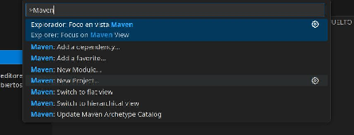

## Apéndice 2. Maven

**Maven** es un **gestor de proyectos** para Java que permite gestionar las dependencias (es decir, descargar y actualizar librerías adicionales si son necesarias) y automatizar la compilación del código en proyectos grandes. También facilita la organización de  archivos y carpetas en proyectos voluminosos.

Existen alternativas a Maven como **Gradle** o **Ant**, pero Maven es el gestor de proyectos más popular en el ecosistema de Java.

Maven es una herramienta externa a Java desarrollada por Apache Foundation, es decir, debes instalarla a parte de tu JDK. Todos los IDEs modernos permiten integración con Maven.

Vamos a ver una introducción a lo que Maven puede hacer por nosotros y cómo lo podemos integrar con Visual Studio Code para desarrollar proyectos Java complejos.

## **Usar Maven desde la línea de comandos**

Maven es una herramienta de consola, es decir, se usa, de forma nativa, desde el terminal de texto.

Para usarlo de este modo, sigue estos pasos:

**1\. Instala Maven** desde la web oficial.

**2\. Abre un terminal** en tu carpeta de trabajo.

**3\. Crea un proyecto Java Simple** en Maven:

**`$ mvn archetype:generate`**

**4\. Edita el archivo pom.xml** para cambiar la configuración del proyecto (más abajo hablamos de este archivo).

**5\. Para compilar** el proyecto:

**`$ mvn compile`**

**6\. Para empaquetar** el proyecto (generar el JAR):

**`$ mvn package`**

## **El archivo pom.xml**

Toda la configuración de Maven se hace en el archivo **pom.xml**, donde se definen cosas como:

  * La versión de Java con la que se compila el proyecto  
  * El nombre del paquete principal y de la clase que contiene el main()  
  * Las dependencias (librerías adicionales) con las que debe compilarse el proyecto

Es raro que necesites escribir un pom.xml desde cero “a mano”. Tu IDE generará un pom.xml utilizable y tú, como mucho, tendrás que editarlo para añadir o quitar algunas cosas o afinar algunos detalles.

Esta es una **estructura típica** de un archivo pom.xml simple:

```xml
<project>     
  <modelVersion>4.0.0</modelVersion>
  <groupId>com.example</groupId> 
  <artifactId>my-project</artifactId>  <!-- Nombre del proyecto -->
  <version>1.0-SNAPSHOT</version>      <!-- Versión del proy. -->
  <properties>`**  
    <maven.compiler.source>
      17                               <!-- Versión de Java -->
    </maven.compiler.target>
  </properties>
  <dependencies>                       <!-- Librerías externas -->
  </dependencies>
</project>
```

## **Usar Maven dentro de Visual Studio Code**

Aunque de momento nuestras aplicaciones son demasiado simples como para necesitar montar un proyecto con Maven, te dejamos aquí, paso a paso, explicado cómo se hace porque, antes o después, vas a necesitar hacerlo conforme avances en este curso de programación.

**1\. Instala la extensión “Maven for Java”** para VS Code, si aún no la tienes.

**2\. Crea un proyecto nuevo con Maven** (Clic derecho en el navegador de archivos → New Java Project → Maven). Alternativamente, puedes hacerlo desde la consola con el comando:

**`mvn archetype:generate -DgroupId=com.tu.paquete -DartifactId=tuProyecto -Dversion=1.0-SNAPSHOT`**

**3\. Visual Studio te preguntará varias cosas**: el nombre del proyecto, el nombre del paquete, la versión (1.0-SNAPSHOT significa “en desarrollo”). Si has usado el comando de consola, no te preguntará nada porque toda esa información ya está incluida en el comando.

**4\. ¡Y listo\! Tu código fuente se ubicará en src/main/java**, dentro del paquete principal que hayas escogido. Ya puedes compilar, empaquetar o editar el pom.xml desde Visual Studio.

Los comandos de Maven siempre están disponibles en la consola de texto, claro, pero puedes acceder a todos ellos desde la paleta de comandos de VS Code:

**1\. Haz clic Ver → Paleta de comandos** (o pulsa Ctrl \+ Mayús \+ P)

**2\. Escribe “Maven”** y te aparecerán todos los comandos disponibles para Maven.


